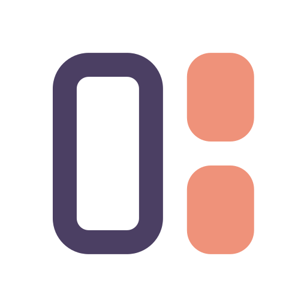

<div align="center">



# MeguvizUI

**面向 Android 原生 View 的强类型 Kotlin UI 库**

布局类型约束 · 属性所有权 · 状态与命令 · 会话生命周期

<br>

[](LICENSE)
[](https://github.com/Meguvizarchic/MeguvizUI)
[](https://github.com/Meguvizarchic/MeguvizUI/issues)
[](https://github.com/Meguvizarchic/MeguvizUI/actions/workflows/verify.yml)
[](https://central.sonatype.com/artifact/io.github.jichuo1.meguviz/meguviz-ui-widgets)

[✨ 特性](#-特性) · [📦 模块](#-模块) · [🚀 快速开始](#-快速开始) · [💡 使用示例](#-使用示例) · [⚠️ 关键行为](#-关键行为) · [📚 文档](#-文档) · [📄 许可证](#-许可证)

</div>

---

<details>
<summary><b>目录</b></summary>

- [✨ 特性](#-特性)
- [📦 模块](#-模块)
- [🚀 快速开始](#-快速开始)
- [💡 使用示例](#-使用示例)
- [⚠️ 关键行为](#-关键行为)
- [📚 文档](#-文档)
- [📄 许可证](#-许可证)

</details>

---

## ✨ 特性

- **强类型布局**：父作用域、控件引用和 LayoutParams 在编译期约束；直接调用原生构造器。
- **明确更新语义**：状态槽可合并，命令保留次数；属性声明比较方式、快照和所有权。
- **会话管理**：绑定、监听、挂载和恢复共享生命周期，过期引用与代际令牌拒绝继续写入。
- **独立核心**：核心仅依赖 Android SDK 与 Kotlin 运行时；Ref、Android 窗口运行时及 Lumen 均通过可选桥接入。

## 📦 模块

| 模块 | Maven artifactId | Central | 职责 |
| --- | --- | --- | --- |
| `ui-core` | `meguviz-ui-core` | ✅ | 会话、引用、属性、调度、恢复与扩展合同 |
| `ui-widgets` | `meguviz-ui-widgets` | ✅ | Framework 工厂、父布局作用域、尺寸与常用属性 |
| `ui-ref-bridge` | `meguviz-ui-ref-bridge` | ✅ | 对接真实 Ref 构造与调用计划 |
| `ui-lumen-bridge` | `meguviz-ui-lumen-bridge` | 未发布 | 将视觉属性所有权交给 Lumen |
| `ui-android-bridge` | `meguviz-ui-android-bridge` | 未发布 | 对接窗口生命周期、资源权威与同一帧驱动 |
| `ui-testkit` | 不发布 | — | 合同测试支持 |

可选 P2 模块均默认关闭，需显式启用，详见 [P2 使用说明](docs/p2.md)。除 `ui-frame-shared` 外均已随 1.0.0 发布到 Central；`ui-frame-shared` 只存在于当前源码候选（`v1.0.0` 标签不含该模块），消费 1.0.0 时不可用：

| 模块 | Maven artifactId | 用途 |
| --- | --- | --- |
| `ui-plan` | `meguviz-ui-plan` | 纯数据计划，分期验证、解析、绑定、挂载 |
| `ui-codegen-api` / `ui-codegen` | `meguviz-ui-codegen-api` / `meguviz-ui-codegen` | KSP 根据显式声明生成直接工厂与 registry 注册入口 |
| `ui-recycler` | `meguviz-ui-recycler` | 可选 RecyclerView 绑定 |
| `ui-text` | `meguviz-ui-text` | 长文本预计算 |
| `ui-layouts` | `meguviz-ui-layouts` | 受限原生横向行 |
| `ui-prewarm` | `meguviz-ui-prewarm` | 可取消的有界主线程预热 |
| `ui-frame-shared` | `meguviz-ui-frame-shared` | 可选的多会话共享帧驱动 |

Android 桥的上游 `meguviz-android-runtime`/`meguviz-android-window` 1.2.0 尚未发布到 Maven Central；Lumen 桥依赖的是 JitPack 上的 Lumen 1.5.5（Central 上的 Lumen 1.6.1 要求消费者用 compileSdk 37.2，本仓库用 37，见 [Lumen 桥](docs/guides/bridges-lumen.md)）。两个桥因此暂不在 Central 提供。

<a id="quick-start"></a>

## 🚀 快速开始

已发布版本为 **`1.0.0`**（Maven Central，groupId `io.github.jichuo1.meguviz`）；源码版本为 `1.2.0`，尚未发布，与 Meguviz 家族统一版本（跳过 1.1.0）。与 1.0.0 的公开 JVM 描述符兼容由 `verifyLegacyAbi` 检查（只增不删）；行为层面尚无历史稳定版兼容证明。API 27 是声明的最低版本；发布门禁 `release` 仍为 blocked：核心设备矩阵、R8 后设备行为、真人 TalkBack、第二家厂商等尚未验收，完整设备、无障碍及性能矩阵尚未完成。

普通应用依赖 `meguviz-ui-widgets` 即可，它会传递依赖 core：

```kotlin
dependencies {
    implementation("io.github.jichuo1.meguviz:meguviz-ui-widgets:1.0.0")
    // 可选：Ref 桥与 P2 模块按需添加，例如
    // implementation("io.github.jichuo1.meguviz:meguviz-ui-ref-bridge:1.0.0")
    // implementation("io.github.jichuo1.meguviz:meguviz-ui-recycler:1.0.0")
}
```

从源码构建需要 JDK 17、Android SDK 37 与 Build Tools 37.0.0，在未提交的 `local.properties` 中配置 `sdk.dir`，然后构建核心、控件与两个示例：

```sh
git clone https://github.com/Meguvizarchic/MeguvizUI.git
cd MeguvizUI
./gradlew verifyHost publishCandidate --no-daemon --max-workers=2
```

Windows 使用 `gradlew.bat`；本地 Maven 候选写入 `build/repo/`。可选桥准备见 [安装说明](docs/installation.md)。

<a id="examples"></a>

## 💡 使用示例

```kotlin
import android.widget.FrameLayout
import io.github.jichuo1.meguviz.ui.CreationEnvironment
import io.github.jichuo1.meguviz.ui.UiSession
import io.github.jichuo1.meguviz.ui.ViewKey
import io.github.jichuo1.meguviz.ui.widgets.FrameScope
import io.github.jichuo1.meguviz.ui.widgets.Properties
import io.github.jichuo1.meguviz.ui.widgets.frameParams

// 在 Activity 的主线程中创建，保留实际 themed Context。
val root = FrameLayout(activity)
val session = UiSession(CreationEnvironment(activity))
val title = FrameScope(session, root).text(ViewKey("title"), frameParams()) {
    text = "Ready"
}
val label = session.bind(title, Properties.plainText())
label.submit("Updated")

// 在所有者销毁时，于主线程释放。
session.close()
```

完整示例见 [standalone](samples/standalone) 与 [xml-interop](samples/xml-interop)。前者包含计数命令、输入模型和布局后恢复；后者展示 AppCompat 的 Factory2、主题与已有 View 的借用。

<a id="behavior"></a>

## ⚠️ 关键行为

1. View 与会话操作在主线程执行。释放后的 `ViewRef` 失效；持有原生 View 的外部代码仍需自行遵守所有权约定。
2. 状态仅在属性显式允许时合并；命令为 FIFO。有序 batch 保持自身顺序，不提供事务回滚。
3. 文本输入、IME 和具有副作用的 setter 应由明确的命令或业务控制器管理。
4. 应用先恢复权威模型，再恢复焦点、选择与滚动；自定义控件需要自己的 codec 或公开恢复适配。
5. Lumen 保留材质与动效职责。Android 桥使用上游帧通道，关闭顺序由窗口所有者协调。
6. Host 构建、设备交互和完整发布验收分别记录；单元测试成功不代表设备矩阵或性能结论。

<a id="documentation"></a>

## 📚 文档

- [文档目录](docs/README.md)
- [安装与接入](docs/installation.md)
- [核心合同](docs/contracts.md)
- [可选桥与依赖边界](docs/bridges.md)
- [P2 可选能力](docs/p2.md)
- [构建、验证与贡献](docs/development.md)
- [公开 API 基线](api/public-api.txt) · [编译夹具](integration/compile-fixtures)

## 📄 许可证

[Apache License 2.0](LICENSE)。第三方组件保留各自的许可证与声明，见 [NOTICE](NOTICE)。
